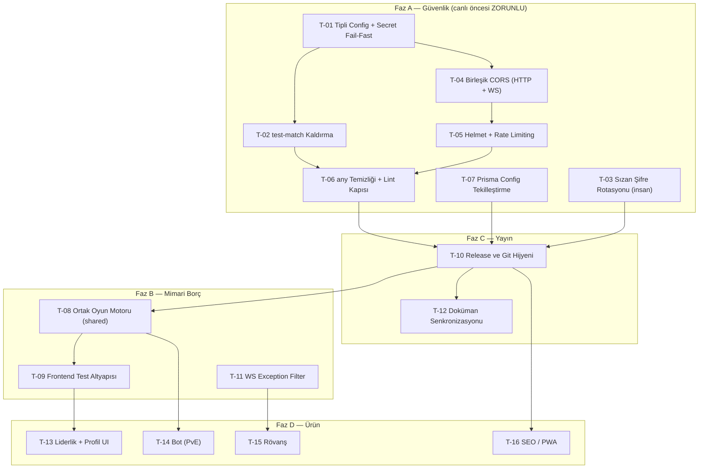
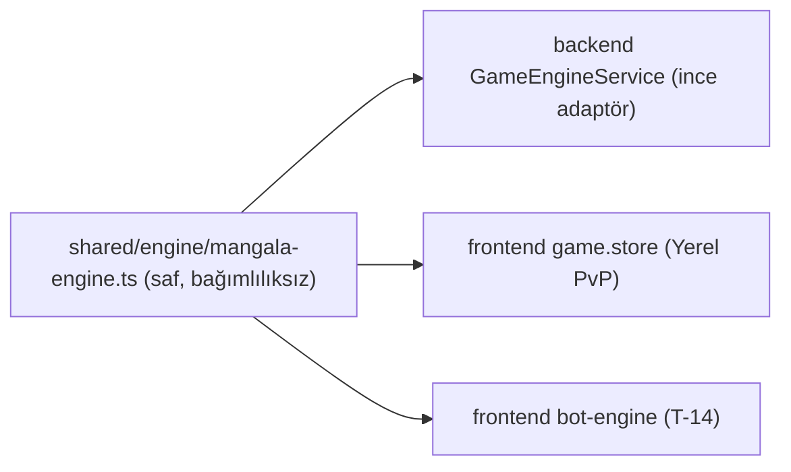

# MANGALA PRIME — MİMARİ TASARIM VE GÖREV DOKÜMANI (v1.0)

> **Hazırlayan:** Sistem Mimarı · **Tarih:** 2026-10-30 · **Durum:** İnsan onayı bekliyor
> **Kapsam:** Yayın öncesi güvenlik sertleştirmesi, mimari borç temizliği, yayın süreci ve Faz 2 ürün özellikleri.
> **Hedef okuyucu:** Geliştirici ajanlar. Her görev (`T-xx`) **tek bir ajan oturumunda** tamamlanacak şekilde tasarlanmıştır.

---

## 0. Geliştirici Ajan İçin Kullanım Talimatı

1. `AGENTS.md` oturum ritüeli **aynen geçerlidir**. Bu doküman anayasayı değiştirmez, ona görev sağlar.
2. Sana hangi `T-xx` görevi verildiyse **yalnızca o görevi** yap. Başka bir görevin kapsamına girme ("Kapsam Dışı" maddelerine özellikle dikkat et).
3. Görevin **"Bağımlılıklar"** satırındaki görevler `develop`'a merge edilmeden başlama.
4. Görevin **"Onay Gerektiren Karar"** satırında listelenen karar (Bölüm 2) "Onaylandı" değilse başlama; insana sor.
5. Her görev için branch adı belirtilmiştir. Base branch her zaman güncel `origin/develop`'tur.
6. Kabul kriterleri = görevin kendi kriterleri **+** `AGENTS.md` genel kriterleri (`npm run test`, `npm run build` yeşil).
7. Oturum sonunda `next-task.md`'ye bu dokümandaki **bir sonraki** görevin ID'sini yaz.

---

## 1. Mevcut Durum Tespiti (Mimari Denetim Bulguları)

Denetim tarihi: 2026-10-30, branch `feature/fix-test-and-backlog` (HEAD `cb952eb`).

| ID | Önem | Bulgu | Kanıt |
|----|------|-------|-------|
| B-01 | 🔴 Kritik | **Kimlik doğrulamasız test endpoint'i canlıda açık.** `POST /test-match` `@Public()`; bilinen şifreli kullanıcılar oluşturuyor, onlar için JWT üretip döndürüyor ve DB'ye maç yazıyor. | `backend/src/app.controller.ts:21-23` |
| B-02 | 🔴 Kritik | **JWT secret'larında hardcoded fallback.** Env eksikse herkesin bildiği anahtarla token imzalanır/doğrulanır. | `auth.service.ts:100,146,150`, `jwt.strategy.ts:12`, `game.gateway.ts:48`, `lobby.gateway.ts:47`, `app.controller.ts:48,52` |
| B-03 | 🔴 Kritik | **Gerçek DB şifresi repoya commit edilmiş** (`.env.example` ve git geçmişi, commit `8ff612d`). | `backend/.env.example:2` |
| B-04 | 🟠 Yüksek | **WebSocket gateway'lerinde CORS tamamen açık** (`origin: '*'`). HTTP whitelist'i socket'leri kapsamıyor. | `game.gateway.ts:20`, `lobby.gateway.ts:19` |
| B-05 | 🟠 Yüksek | **HTTP CORS fallback'i açık:** `CORS_ORIGIN` yoksa `origin: true` (her origin kabul). | `backend/src/main.ts:17-19` |
| B-06 | 🟠 Yüksek | **Helmet ve rate limiting yok.** Login/register brute-force'a açık. Spec 13.2'deki `429 RATE_LIMITED` hiç üretilmiyor. | `backend/package.json` |
| B-07 | 🟠 Yüksek | **`any` yasağı ihlal ediliyor ve lint ile korunmuyor.** ESLint'te kural bilinçli kapatılmış, CI'da lint adımı yok. | `lobby.gateway.ts:188,253` (`as any`), `app.controller.ts:23` (`Promise<any>`), `backend/eslint.config.mjs:29` |
| B-08 | 🟡 Orta | **Oyun motoru iki kopya.** Backend `GameEngineService` ve frontend `processLocalMove` ayrı ayrı yazılmış (167 / 143 satır). Kurallar ayrışırsa Online ve Yerel PvP farklı sonuç verir. | `backend/src/game/game-engine.service.ts`, `frontend/src/lib/game-engine.ts` |
| B-09 | 🟡 Orta | **İki farklı `prisma.config.ts`.** Kökteki (Dockerfile bunu kullanıyor) dummy URL fallback'i içeriyor; `prisma/prisma.config.ts` kullanılmıyor. | `/prisma.config.ts`, `/prisma/prisma.config.ts` |
| B-10 | 🟡 Orta | **Frontend'de test yok.** `"test": "echo 'No tests for frontend'"`. | `frontend/package.json` |
| B-11 | 🟡 Orta | **Spec'te tanımlı `ws-exception.filter.ts` yok.** WebSocket hataları her handler'da elle formatlanıyor. | Spec Bölüm 13.3 ve 17 |
| B-12 | 🟡 Orta | **Git akışı dağınık.** Aktif branch push edilmemiş, yerel `develop` eski, `origin/develop` `main`'den 84 commit ileride, 20+ eski branch duruyor. | `git branch -a` |
| B-13 | 🔵 Düşük | **Doküman ve gerçek uyumsuz.** `current-state.md` güvenlik sertleştirmesini ✅ gösteriyor. Spec 10.2 hâlâ "db push + PM2" diyor (gerçek: Docker + `migrate deploy`). Spec 17 frontend klasör yapısı gerçekle uyuşmuyor (`pages/` yok, `components/` düz). AGENTS.md LibSQL'den bahsediyor (gerçek: `@prisma/adapter-pg`). | — |
| B-14 | 🔵 Düşük | `ws-test.html` kökte duruyor ve `/test-match`'e bağımlı. | `/ws-test.html` |

---

## 2. Onay Gerektiren Mimari Kararlar

> Anayasa: "Kendi başına yeni klasör icat edemezsin." Aşağıdaki kararlar **insan tarafından onaylanmadan** ilgili görev başlatılamaz. Onaylanan karar spec'e işlenir (T-12).

| ID | Karar | Mimar Önerisi | Etkilediği Görev | Durum |
|----|-------|---------------|------------------|-------|
| K-1 | Saf oyun motoru `shared/engine/` altına taşınsın. | **Önerilir.** Tek kaynak; Bot (T-14) da bunu kullanacak. | T-08, T-14 | ⬜ Bekliyor |
| K-2 | Backend'e `common/config/` (tipli env yükleyici) ve `common/adapters/` (socket CORS adapter) klasörleri eklensin. | **Önerilir.** | T-01, T-04 | ⬜ Bekliyor |
| K-3 | `POST /test-match` ve `ws-test.html` **tamamen silinsin** (dev-only flag ile saklanmasın). | **Önerilir.** Test ihtiyacı seed + iki tarayıcı ile karşılanıyor. | T-02 | ⬜ Bekliyor |
| K-4 | Sızan DB şifresi için: (a) yalnızca şifre rotasyonu **veya** (b) rotasyon + git geçmişi temizliği (`git filter-repo`, force-push). | **(a) zorunlu, (b) opsiyonel.** Repo private ise (a) yeterli. | T-03 | ⬜ Bekliyor |
| K-5 | Spec Bölüm 17 frontend klasör yapısı **gerçeğe göre güncellensin** (frontend refactor edilmesin). | **Önerilir.** Refactor değer üretmez, risk üretir. | T-12 | ⬜ Bekliyor |
| K-6 | Rate limit değerleri (Bölüm T-05 tablosu). | Tablodaki değerler. | T-05 | ⬜ Bekliyor |
| K-7 | Rövanş yeni `Match` kaydı olarak mı açılsın, aynı kayıt mı sıfırlansın? | **Yeni kayıt.** ELO geçmişi temiz kalır. | T-15 | ⬜ Bekliyor |

---

## 3. Fazlar ve Bağımlılık Grafiği



**Önerilen sıra:** T-01 → T-02 → T-04 → T-05 → T-06 → T-07 (T-03 paralelde insan tarafından) → **T-10 (canlıya çıkış)** → T-12 → T-08 → T-11 → T-09 → T-13 → T-14 → T-15 → T-16

---

## 4. Faz A — Güvenlik Sertleştirmesi

### T-01 · Tipli Config Modülü ve Secret Fail-Fast

| Alan | Değer |
|------|-------|
| Branch | `feature/config-hardening` |
| Öncelik | 🔴 P0 |
| Bağımlılık | — |
| Onay gerektiren karar | K-2 |
| Çözdüğü bulgu | B-02, B-05 (kısmen) |
| Spec / Skill | Spec 8, 11 · `skills/api-contract.md`, `skills/testing.md` |

**Problem:** Env değişkenleri koda dağılmış durumda (`process.env.X || 'fallback'`). Tek bir doğrulama noktası yok.

**Tasarım:**
- Yeni dosya: `backend/src/common/config/app-config.ts`
  - Tipli, `readonly` bir `AppConfig` arayüzü export eder: `nodeEnv`, `port`, `jwtSecret`, `jwtRefreshSecret`, `corsOrigins: readonly string[]`, `turnTimeLimitSecs`, `databaseUrl`.
  - `loadAppConfig(env: NodeJS.ProcessEnv): AppConfig` → **saf fonksiyon** (test edilebilir). Kurallar:
    - `JWT_SECRET`, `JWT_REFRESH_SECRET`: zorunlu, ≥ 32 karakter, ikisi birbirinden farklı. Değilse `Error` fırlatır.
    - `NODE_ENV=production` iken `CORS_ORIGIN` zorunlu ve boş olamaz. Development'ta varsayılan `http://localhost:5173`.
    - `DATABASE_URL`: zorunlu.
    - `GAME_TURN_TIME_LIMIT_SECS`: opsiyonel, varsayılan 59, 10–300 aralığı dışındaysa hata.
    - Hata mesajı **hangi değişkenin** eksik veya geçersiz olduğunu söyler ama değeri asla loglamaz.
- `ConfigModule` (aynı klasörde `config.module.ts`): `APP_CONFIG` injection token'ı ile `AppConfig`'i global provider yapar.
- `main.ts`: Nest uygulaması oluşturulmadan **önce** `loadAppConfig(process.env)` çağrılır. Hata varsa `process.exit(1)` (fail-fast).
- `JwtModule` `AuthModule` içinde `registerAsync` ile `APP_CONFIG`'den secret alır. **Servislerde `signAsync`/`verifyAsync` çağrılarına `secret:` parametresi geçilmez** (access token için). Refresh token için `AuthService` `APP_CONFIG.jwtRefreshSecret`'i inject ederek kullanır.
- `jwt.strategy.ts`, `game.gateway.ts`, `lobby.gateway.ts`, `game.service.ts` → `process.env` okumaları kaldırılır, `APP_CONFIG` inject edilir.
- Jest: `backend/test/setup-env.ts` dosyası test değerlerini (`JWT_SECRET` vb.) set eder, `package.json > jest.setupFiles`'a eklenir.

**Adımlar:**
1. `app-config.ts` + `config.module.ts` yaz.
2. `app-config.spec.ts` yaz (aşağıdaki testler).
3. Tüm `process.env.JWT_*`, `process.env.CORS_ORIGIN`, `process.env.GAME_TURN_TIME_LIMIT_SECS` kullanımlarını config'e geçir.
4. `grep -rn "fallback_" backend/src` → **0 sonuç** olmalı.
5. `backend/.env.example` değerlerini placeholder yap (`JWT_SECRET="<64+ karakter rastgele>"`). Gerçek şifre içermemeli (bkz. T-03).

**Zorunlu testler (`app-config.spec.ts`):**
- `should_throw_when_jwt_secret_missing`
- `should_throw_when_jwt_secret_shorter_than_32`
- `should_throw_when_access_and_refresh_secrets_equal`
- `should_require_cors_origin_in_production`
- `should_default_cors_origin_in_development`
- `should_parse_comma_separated_cors_origins`
- `should_reject_turn_limit_out_of_range`

**Kabul kriterleri:**
- [ ] `grep -rnE "process\.env\.(JWT|CORS)" backend/src` → yalnızca `app-config.ts` içinde.
- [ ] `JWT_SECRET` olmadan `npm run start:prod` → anlaşılır hata mesajıyla çıkış kodu 1.
- [ ] Mevcut 74 test + yeni testler yeşil.

**Kapsam dışı:** CORS'un socket'lere uygulanması (T-04), `/test-match` (T-02).

---

### T-02 · Test Endpoint'i ve Debug Artıklarının Kaldırılması

| Alan | Değer |
|------|-------|
| Branch | `feature/remove-debug-endpoints` |
| Öncelik | 🔴 P0 |
| Bağımlılık | T-01 |
| Onay gerektiren karar | K-3 |
| Çözdüğü bulgu | B-01, B-14, B-07 (kısmen) |

**Tasarım:**
- `AppController.createTestMatch` ve ona ait tüm import ve constructor bağımlılıkları (`GameService`, `PrismaService`, `AuthService`, `JwtService`) silinir.
- `AppController` boş kalırsa bir health endpoint'e dönüştürülür: `@Public() @Get('health')` → `{ data: { status: 'ok' } }` (Docker healthcheck ve UAT için faydalı). Dönüş tipi açıkça yazılır.
- `ws-test.html` silinir.
- `.gitignore`'a `.obsidian/` eklenir.
- Seed'deki test kullanıcıları (`prisma/seed.ts`) incelenir. Production'da seed **çalıştırılmadığı** CI ve Dockerfile'da doğrulanır. Çalışıyorsa `NODE_ENV !== 'production'` koruması eklenir.

**Kabul kriterleri:**
- [ ] `grep -rn "test-match\|testplayer" backend/src` → 0 sonuç.
- [ ] `POST /test-match` → 404.
- [ ] `GET /health` → 200 `{ data: { status: 'ok' } }`, test ile doğrulanmış.

---

### T-03 · Sızan Veritabanı Şifresinin Rotasyonu (İNSAN GÖREVİ)

| Alan | Değer |
|------|-------|
| Sorumlu | **İnsan (VPS erişimi gerekir)**; ajan yalnızca repo tarafını yapar |
| Öncelik | 🔴 P0 |
| Onay gerektiren karar | K-4 |
| Çözdüğü bulgu | B-03 |

**Adımlar:**
1. (İnsan) VPS'te PostgreSQL kullanıcı şifresini değiştir: `ALTER USER postgres WITH PASSWORD '<yeni>';`
2. (İnsan) VPS `.env` / GitHub Secrets içindeki `DATABASE_URL`'i güncelle. Aynı anda **JWT secret'larını da yenile** (mevcut fallback'ler sızmış kabul edilir; tüm oturumlar düşer, bu kabul edilebilir).
3. (Ajan, T-01 içinde) `.env.example` placeholder'a çevrilir. `docker-compose.yml` ve `docker/` altında gömülü şifre varsa env referansına çevrilir.
4. (İnsan, K-4(b) seçilirse) `git filter-repo` ile geçmiş temizliği ve force-push. Tüm yerel klonlar yeniden alınmalıdır.

**Kabul kriterleri:**
- [ ] `git grep -n "400B1teker"` (HEAD) → 0 sonuç.
- [ ] Eski şifreyle VPS DB'ye bağlantı reddediliyor.

---

### T-04 · Birleşik CORS Politikası (HTTP + WebSocket)

| Alan | Değer |
|------|-------|
| Branch | `feature/unified-cors` |
| Öncelik | 🟠 P1 |
| Bağımlılık | T-01 |
| Onay gerektiren karar | K-2 |
| Çözdüğü bulgu | B-04, B-05 |
| Skill | `skills/websocket.md` |

**Problem:** `@WebSocketGateway` decorator'ı statik olduğu için config okuyamıyor; bu yüzden `origin: '*'` yazılmış.

**Tasarım:**
- Yeni dosya: `backend/src/common/adapters/configured-io.adapter.ts`
  - `IoAdapter`'ı extend eder ve constructor'da `AppConfig` alır.
  - `createIOServer(port, options)` override edilir: `cors: { origin: config.corsOrigins, credentials: true }` zorla uygulanır.
- `main.ts`: `app.useWebSocketAdapter(new ConfiguredIoAdapter(app, config))`.
- `main.ts` HTTP CORS: `origin: config.corsOrigins` (artık `true` fallback'i yok).
- Gateway decorator'larından `cors` alanı **kaldırılır** (tek kaynak adapter olur).

**Kabul kriterleri:**
- [ ] `grep -rn "origin: '\*'\|origin: true" backend/src` → 0 sonuç.
- [ ] Whitelist dışı bir origin'den socket handshake → reddedilir (manuel: farklı porttan `ws-test`, veya `socket.io-client` ile `extraHeaders.origin` testi).
- [ ] Whitelist'teki origin'den lobi ve oyun bağlantısı çalışıyor (iki tarayıcıyla uçtan uca test).

---

### T-05 · Helmet ve Rate Limiting

| Alan | Değer |
|------|-------|
| Branch | `feature/helmet-throttler` |
| Öncelik | 🟠 P1 |
| Bağımlılık | T-04 |
| Onay gerektiren karar | K-6 |
| Çözdüğü bulgu | B-06 |
| Spec | 13.2 (`429 RATE_LIMITED`) |

**Tasarım — HTTP:**
- Paketler: `helmet`, `@nestjs/throttler`.
- `main.ts`:
  - `app.getHttpAdapter().getInstance().set('trust proxy', 1)`: Nginx Proxy Manager arkasında gerçek IP'nin alınması için **zorunlu**. Bu olmazsa tüm kullanıcılar tek IP gibi görünür ve hep birlikte limitlenir.
  - `app.use(helmet({...}))`. Backend frontend'i `ServeStatic` ile sunduğu için CSP **PixiJS ile uyumlu** ayarlanmalı:
    - `default-src 'self'`
    - `script-src 'self'`
    - `style-src 'self' 'unsafe-inline'` (React inline style)
    - `img-src 'self' data: blob:`
    - `connect-src 'self' wss: ws:` (prod'da yalnızca `wss:`)
    - `worker-src 'self' blob:`
    - `font-src 'self' data:`
  - CSP sonrası oyun tahtası, ses (Web Audio) ve animasyonlar tarayıcıda **elle doğrulanmalı**. Konsolda CSP ihlali olmamalı.
- `AppModule`: `ThrottlerModule.forRoot` + global `ThrottlerGuard` (`APP_GUARD`).

**Rate limit tablosu (K-6):**

| Hedef | Limit | Pencere | Anahtar |
|-------|-------|---------|---------|
| Global HTTP varsayılanı | 100 istek | 60 sn | IP |
| `POST /auth/login` | 5 istek | 60 sn | IP |
| `POST /auth/register` | 3 istek | 10 dk | IP |
| `POST /auth/refresh` | 20 istek | 60 sn | IP |
| `GET /health` | `@SkipThrottle()` | — | — |
| WS bağlantı (`/lobby`, `/game`) | 20 bağlantı | 60 sn | IP |
| WS `game:chat_message` | 5 mesaj | 10 sn | userId |
| WS `game:move` | 10 olay | 5 sn | userId |

- **429 formatı:** `HttpExceptionFilter`, `ThrottlerException`'ı `{ error: { code: 'RATE_LIMITED', message: 'Çok fazla istek. Lütfen biraz bekleyin.' } }` olarak döndürmeli.
- **WS rate limit tasarımı:** `@nestjs/throttler` WS'de güvenilir çalışmadığı için **saf, test edilebilir** bir `SlidingWindowLimiter` sınıfı yazılır (`backend/src/common/guards/sliding-window-limiter.ts`; `guards` klasörü spec 17'de yoksa K-2 kapsamında onaylanmalı). Sınıf zamanı parametre olarak alır (`now: number`), böylece Jest'te fake timer gerekmez. Gateway'ler limit aşımında `lobby:error` / `game:error` ile `RATE_LIMITED` döner. Bağlantı limitinde socket `disconnect(true)` edilir.
- Limiter içindeki Map'ler periyodik temizlenmeli (memory leak önlemi).

**Zorunlu testler:**
- `sliding-window-limiter.spec.ts`: limit içi izin, limit aşımı ret, pencere kayınca yeniden izin, farklı anahtarların bağımsızlığı, temizlik.
- `auth.controller` e2e veya unit: 6. login denemesi → 429 + doğru error formatı.

**Kabul kriterleri:**
- [ ] `curl -I` yanıtında `Content-Security-Policy`, `X-Content-Type-Options`, `Strict-Transport-Security` başlıkları var.
- [ ] 6 hızlı login denemesi → 6.'sı 429 `RATE_LIMITED`.
- [ ] Oyun tahtası, ses ve socket bağlantıları CSP altında sorunsuz çalışıyor (manuel).

---

### T-06 · `any` Temizliği ve Lint Kapısı

| Alan | Değer |
|------|-------|
| Branch | `feature/strict-lint-gate` |
| Öncelik | 🟠 P1 |
| Bağımlılık | T-02, T-05 |
| Çözdüğü bulgu | B-07 |

**Tasarım:**
- `lobby.gateway.ts`'teki `(error as any).response?.code` yerine bir tip koruyucu kullanılır. Yer: `backend/src/common/filters/` altında `error-code.util.ts` (yeni dosya, mevcut klasör):
  ```ts
  // Tasarım imzası. Gövde ajan tarafından yazılır.
  export function extractErrorCode(error: unknown, fallback: string): string
  ```
  `HttpException` ise `getResponse()` objesinden `code: string` alanını **tip daraltma** ile okur. Değilse `fallback` döner.
- `backend/eslint.config.mjs`: `'@typescript-eslint/no-explicit-any': 'error'`. `src/generated/**` lint'ten hariç tutulur (`ignores`).
- Frontend ESLint'te de aynı kural `error` olmalı.
- Root `package.json`'a `"lint": "npm run lint -w backend && npm run lint -w frontend"` eklenir. Backend'de `lint` script'i yoksa eklenir.
- `.github/workflows/ci-cd.yml`: test adımından önce `npm run lint` adımı. Lint hatası pipeline'ı kırar.
- Mevcut lint hataları bu görevde **sıfırlanır** (sadece `any` değil, tüm `error` seviyesi bulgular). Kuralları gevşeterek "çözmek" **yasaktır**.

**Kabul kriterleri:**
- [ ] `grep -rnE ":\s*any\b|as any|<any>" backend/src frontend/src shared --include=*.ts --include=*.tsx | grep -v generated` → 0.
- [ ] `npm run lint` → 0 error.
- [ ] CI'da lint adımı görünür ve yeşil.

---

### T-07 · Prisma Config Tekilleştirme

| Alan | Değer |
|------|-------|
| Branch | `feature/prisma-config-single-source` |
| Öncelik | 🟡 P2 |
| Bağımlılık | — |
| Çözdüğü bulgu | B-09 |
| Skill | `skills/prisma.md` (Prisma 7 kuralları: `earlyAccess` ve `client.adapter` YASAK) |

**Tasarım:**
- **Tek kaynak:** kökteki `/prisma.config.ts` (Dockerfile bunu kopyalıyor). `/prisma/prisma.config.ts` silinir.
- Kökteki dosyadan `dummy_password_for_ci_only` fallback'i kaldırılır, `env('DATABASE_URL')` kullanılır.
- CI'da `npx prisma generate` adımına workflow seviyesinde `env: DATABASE_URL: postgresql://ci:ci@localhost:5432/ci` verilir (kodda değil, CI'da).
- Seed komutu tek olmalı. `backend/package.json > prisma.seed` ile `prisma.config.ts > migrations.seed` çakışıyorsa yalnızca `prisma.config.ts` kalır.
- Doğrulama: `npx prisma validate`, `npx prisma generate`, Docker build, `migrate deploy` (yerel Postgres'e).

**Kabul kriterleri:**
- [ ] Repoda yalnızca bir `prisma.config.ts`.
- [ ] `docker build .` başarılı, konteynerde `npx prisma migrate deploy` çalışıyor.
- [ ] Kodda hiçbir DB URL fallback'i yok.

---

## 5. Faz B — Mimari Borç

### T-08 · Ortak (Shared) Saf Oyun Motoru

| Alan | Değer |
|------|-------|
| Branch | `feature/shared-game-engine` |
| Öncelik | 🟡 P2 |
| Bağımlılık | T-10 (canlıya çıkış sonrası yapılmalı; kural motoruna dokunduğu için yüksek riskli) |
| Onay gerektiren karar | K-1 |
| Çözdüğü bulgu | B-08 |
| Spec / Skill | Spec 4, 19.1 · `skills/game-engine.md` |

**Hedef mimari:**



**Tasarım:**
- Yeni klasör: `shared/engine/`
  - `mangala-engine.ts` export eder:
    - `applyMove(board: BoardState, pitIndex: number, player: Player): MoveResult`
    - `getLegalMoves(board: BoardState, player: Player): number[]` (Bot ve UI vurgulama için)
    - `createInitialBoard(): BoardState`
    - `class MangalaRuleError extends Error { readonly code: MangalaRuleErrorCode }`
    - `type MangalaRuleErrorCode = 'INVALID_BOARD' | 'INVALID_PIT' | 'NOT_YOUR_PIT' | 'EMPTY_PIT'`
  - **Kurallar:** Hiçbir framework importu yok (`@nestjs/*`, React vb.). Girdi board'u mutate edilmez (immutability). Yalnızca `shared/types`'tan import edilir.
  - `index.ts` barrel export.
- `shared/tsconfig.json > include`: `["types/**/*", "engine/**/*"]`. `shared/package.json` ve vite/jest alias'ları (`@mangala/shared` → şu an `../shared/types`'a işaret ediyor) yeni yapıya göre güncellenir. **Alias çözümlemesi backend Jest, backend build, frontend Vite dev ve build, Docker build olmak üzere 5 ortamda da doğrulanmalı.**
- Backend `GameEngineService.processMove` → `applyMove`'u çağırır, `MangalaRuleError`'ı `BadRequestException({ code, message })`'a çevirir. Public API **değişmez** (gateway etkilenmez).
- Frontend `processLocalMove` silinir, `game.store` doğrudan `applyMove` kullanır.

**Güvenli geçiş adımları (sıra önemli):**
1. **Ayrışma tespiti (önce):** İki mevcut motoru karşılaştıran geçici bir diferansiyel test yaz. Seed'li rastgele 1000 oyun, her hamlede iki motorun `MoveResult`'ı eşit mi diye bakılır. **Ayrışma bulunursa backend motoru doğru kabul edilir** (onaylı 8 testi var). Ayrışma raporu PR açıklamasına yazılır.
2. Backend motorunu `shared/engine/`'e taşı (davranış birebir aynı kalır).
3. Spec 19.1'deki 8 zorunlu test shared motoru hedefleyecek şekilde taşınır (backend Jest üzerinden çalışabilir: `backend/src/game/mangala-engine.spec.ts` → `@mangala/shared` import eder). Ek testler: `getLegalMoves`, immutability, `MangalaRuleError` kodları.
4. Backend adaptörünü bağla, gateway testlerini çalıştır.
5. Frontend'i bağla, `frontend/src/lib/game-engine.ts`'i sil.
6. Diferansiyel testi sil (artık tek motor var).

**Kabul kriterleri:**
- [ ] `frontend/src/lib/game-engine.ts` yok. `grep -rn "processLocalMove"` → 0.
- [ ] `shared/engine` içinde `@nestjs` veya `react` importu yok.
- [ ] 8 zorunlu motor testi + yeni testler yeşil.
- [ ] Manuel: Yerel PvP ve Online PvP'de hazine ekstra hamlesi, çiftleme ve Turan aynı şekilde çalışıyor.

---

### T-09 · Frontend Test Altyapısı

| Alan | Değer |
|------|-------|
| Branch | `feature/frontend-tests` |
| Öncelik | 🟡 P2 |
| Bağımlılık | T-08 |
| Çözdüğü bulgu | B-10 |
| Skill | `skills/testing.md`, `skills/frontend.md` |

**Tasarım:**
- Paketler (devDependencies): `vitest`, `@testing-library/react`, `@testing-library/user-event`, `@testing-library/jest-dom`, `jsdom`.
- `frontend/vite.config.ts` içinde `test` bloğu (ayrı config dosyası açılmaz): `environment: 'jsdom'`, `setupFiles`.
- `frontend/package.json`: `"test": "vitest run"`. Root `npm run test` zaten frontend'i çağırıyor, CI otomatik kapsar.
- PixiJS ve Web Audio **mock'lanır**. Canvas render testi yazılmaz (kapsam dışı).

**Zorunlu test dosyaları:**

| Dosya | Senaryolar |
|-------|-----------|
| `stores/auth.store.spec.ts` | Login sonrası token memory'de, logout temizler, token localStorage'a **yazılmaz** (spec 11.1) |
| `lib/api-client.spec.ts` | 401 → `/auth/refresh` çağrılır → orijinal istek tekrarlanır; refresh de 401 dönerse logout; eşzamanlı 401'lerde tek refresh |
| `stores/game.store.spec.ts` | Yerel PvP: başlangıç tahtası, geçerli hamle sırayı değiştirir, hazine hamlesinde sıra korunur, oyun sonu tespiti |
| `components/AuthGuard.spec.tsx` | Token yoksa login'e yönlendirir |

**Kabul kriterleri:**
- [ ] `npm run test -w frontend` gerçek testler çalıştırıyor ve yeşil.
- [ ] CI pipeline'ında frontend test sonuçları görünüyor.

---

### T-11 · WebSocket Exception Filter (Spec Uyumu)

| Alan | Değer |
|------|-------|
| Branch | `feature/ws-exception-filter` |
| Öncelik | 🟡 P2 |
| Bağımlılık | T-06 |
| Çözdüğü bulgu | B-11 |
| Spec / Skill | 13.3, 17 · `skills/websocket.md` |

**Tasarım:**
- `backend/src/common/filters/ws-exception.filter.ts` (spec 17'de zaten tanımlı, yeni klasör yok).
- `BaseWsExceptionFilter` extend edilir. Yakalanan hata namespace'e göre `game:error` veya `lobby:error` event'i olarak `{ error: { code, message } }` formatında emit edilir. `extractErrorCode` (T-06) yeniden kullanılır.
- Beklenmeyen hata → `INTERNAL_ERROR`. Stack trace istemciye **gönderilmez**, sunucuda loglanır.
- Gateway'lerdeki tekrarlayan `try/catch → client.emit('x:error')` blokları filtreye devredilir. **İstisna:** `INVALID_MOVE` durumunda spec 13.3 gereği `board` alanı da gönderilmeli; bu durum gateway'de açıkça ele alınmaya devam eder.

**Kabul kriterleri:**
- [ ] Gateway'lerde elle yazılmış error emit sayısı azaldı (PR'da önce/sonra sayısı).
- [ ] Filtre için unit test: `HttpException` → doğru code; bilinmeyen hata → `INTERNAL_ERROR`.

---

## 6. Faz C — Yayın

### T-10 · Release Süreci ve Git Hijyeni

| Alan | Değer |
|------|-------|
| Sorumlu | Ajan + İnsan (merge onayları insanda) |
| Öncelik | 🔴 P0 (Faz A bitince) |
| Bağımlılık | T-01…T-07, T-03 |
| Çözdüğü bulgu | B-12 |

**Adımlar:**
1. `feature/fix-test-and-backlog` push edilir ve `develop`'a PR açılır (bu branch Faz A'dan **önce** merge edilmelidir; Faz A branch'leri onun üzerine açılır).
2. Faz A PR'ları sırayla `develop`'a merge edilir.
3. `develop` → `main` PR'ı açılır. PR açıklamasına 84+ commit'lik değişiklik özeti ve Faz A güvenlik değişiklikleri yazılır.
4. Merge sonrası `v1.0.0` tag'i atılır (`git tag -a v1.0.0`).
5. **(İnsan) GitHub branch protection:** `main` ve `develop` için "Require PR", "Require status checks (CI)", "No force push".
6. **Canlı UAT (insan + ajan):**
   - [ ] `GET /health` → 200
   - [ ] Kayıt, giriş ve sayfa yenileme sonrası sessiz refresh
   - [ ] 6 hızlı yanlış login → 429
   - [ ] İki farklı cihazla Hızlı Maç → oyun → bitiş → ELO değişti
   - [ ] Bir sekmeyi kapat, 60 sn içinde dön → oyun devam
   - [ ] Yerel PvP baştan sona
   - [ ] Mobil yatay mod
   - [ ] Tarayıcı konsolunda CSP veya CORS hatası yok
7. Merge edilmiş eski branch'ler hem yerelde hem remote'ta silinir (`feature/*` listesi PR'a eklenir, silme insan onayıyla).

**Rollback planı:** Önceki Docker image tag'i VPS'te tutulur. Sorun olursa `docker compose` ile önceki tag'e dönülür. Migration'lar yalnızca ekleyici olmalı (bu fazda şema değişikliği yok).

---

### T-12 · Doküman Senkronizasyonu

| Alan | Değer |
|------|-------|
| Branch | `docs/architecture-sync` |
| Öncelik | 🔵 P3 |
| Bağımlılık | T-10 |
| Onay gerektiren karar | K-5 |
| Çözdüğü bulgu | B-13 |

**Yapılacaklar:**
- `spec.md` Bölüm 10.2: Pipeline'ı gerçeğe göre yaz (Docker build, GHCR veya rsync, `prisma migrate deploy`, lint adımı).
- `spec.md` Bölüm 17: Onaylanan K-1/K-2 klasörleri (`shared/engine`, `common/config`, `common/adapters`, `common/guards`) ve frontend'in gerçek yapısı (K-5).
- `spec.md` Bölüm 8: Rate limit tablosu ve CSP politikası eklenir.
- `AGENTS.md`: Prisma satırındaki "LibSQL" örneği "`@prisma/adapter-pg`" olarak düzeltilir (**AGENTS.md değişikliği insan onayı gerektirir**).
- `current-state.md`: Modül tablosuna "Güvenlik Sertleştirmesi" satırları gerçek durumuyla.
- `production-backlog.md`: Tamamlanan maddeler işaretlenir, bu dokümana referans verilir.
- `REVIEW_CHECKLIST.md`: "PM2 servisi çalışıyor" → "Docker konteyner sağlıklı (`/health`)".

---

## 7. Faz D — Ürün Özellikleri (Canlı Sonrası)

### T-13 · Liderlik Tablosu ve Profil Arayüzü

| Alan | Değer |
|------|-------|
| Branch | `feature/leaderboard-profile-ui` |
| Bağımlılık | T-09 |
| Skill | `skills/frontend.md`, `skills/api-contract.md` |

**Tasarım:**
- Backend hazır: `GET /users/leaderboard`, `GET /users/me`, `GET /users/:username`. **Backend'e dokunulmaz.** Eksik alan görülürse ayrı görev olarak raporlanır.
- Yeni bileşenler: `frontend/src/components/LeaderboardModal.tsx`, `frontend/src/components/ProfileModal.tsx`.
- Veri çekme `api-client.ts` üzerinden yapılır. Response tipleri `shared/types/api-response.types.ts`'ten alınır (yoksa oraya eklenir, frontend'de tip **tekrar tanımlanmaz**).
- Liderlik: sıra, kullanıcı adı, ELO, G/M, galibiyet oranı. Kendi satırı vurgulanır. Loading, boş ve hata durumları zorunlu.
- Profil: ELO, toplam maç, son 20 maç (rakip, sonuç, ELO değişimi, tarih, Friendly etiketi).
- Erişim: Lobi üst barında iki buton. Mobilde tam ekran modal. Aktif tema ile uyumlu.
- Testler (Vitest): loading/hata/veri render, kendi satır vurgusu.

**Kabul kriterleri:** Mobil (<768px) ve masaüstünde düzgün görünüm. Hata durumunda kullanıcı dostu mesaj. 4 temada da okunabilir.

---

### T-14 · Bot (PvE) Modu

| Alan | Değer |
|------|-------|
| Branch | `feature/pve-bot` |
| Bağımlılık | T-08 (ortak motor **şart**) |

**Tasarım:**
- Yeni dosya: `frontend/src/lib/bot-engine.ts`. **Saf** fonksiyon: `chooseBotMove(board: BoardState, botPlayer: Player, level: BotLevel): number`.
- `type BotLevel = 'easy' | 'medium' | 'hard'`
  - **easy:** `getLegalMoves`'tan rastgele (RNG parametre olarak enjekte edilir, test edilebilirlik için).
  - **medium:** Açgözlü heuristic. Öncelik sırası: ekstra hamle veren hamle > en çok taş yakalayan hamle > rakibe en az fırsat bırakan hamle.
  - **hard:** Minimax + alpha-beta, derinlik 6. Değerlendirme: `(botHazine − rakipHazine)` + ekstra hamle bonusu. Ekstra hamlede aynı oyuncu tekrar oynar (derinlik azaltılmaz).
- Simülasyon **yalnızca** `shared/engine.applyMove` ile yapılır, kural tekrar yazılmaz.
- UX: Bot hamlesi öncesi 600–1200 ms "düşünüyor" gecikmesi. Hard seviye ana thread'i 50 ms'den uzun bloklarsa Web Worker'a alınır (CSP `worker-src blob:` T-05'te hazır).
- Bot oyunları backend'e **gönderilmez**, ELO etkilenmez. `game.store`'a `mode: 'online' | 'local' | 'bot'` eklenir.
- Lobi: "Bota Karşı Oyna" butonu ve seviye seçimi.

**Zorunlu testler:** Her seviye her zaman yasal hamle döner. Medium, ekstra hamle varsa onu seçer. Hard, 1 hamlede kazanılan pozisyonda kazanan hamleyi bulur. Hard hamle süresi < 500 ms (orta segment donanımda).

---

### T-15 · Rövanş (Rematch)

| Alan | Değer |
|------|-------|
| Branch | `feature/rematch` |
| Bağımlılık | T-11 |
| Onay gerektiren karar | K-7 |
| Skill | `skills/websocket.md` |

**WebSocket sözleşmesi** (önce `shared/types/socket-events.types.ts`'e eklenir):

| Event | Yön | Payload |
|-------|-----|---------|
| `game:rematch_offer` | C→S | `{ matchId }` |
| `game:rematch_offered` | S→C (rakibe) | `{ matchId, fromUserId, expiresAt }` |
| `game:rematch_response` | C→S | `{ matchId, accept: boolean }` |
| `game:rematch_declined` | S→C | `{ matchId }` |
| `game:rematch_start` | S→C (ikisine) | `{ oldMatchId, newMatchId }` |

**Kurallar:**
- Yalnızca `FINISHED` durumundaki maç için ve iki oyuncu da bağlıyken teklif edilebilir.
- Teklif 30 sn geçerli. Süre dolarsa `declined` sayılır. Teklif başına tek aktif istek; spam rate limiter'a (T-05) tabidir.
- Kabulde **yeni `Match` kaydı** açılır (K-7). P1 ve P2 rolleri yer değiştirir. Aynı-IP → Friendly kuralı (spec 8.2) yeni maçta da uygulanır.
- Oyunculardan biri lobiye dönerse bekleyen teklif iptal edilir.
- Frontend: Oyun sonu modalında "Rövanş Teklif Et" butonu, gelen teklif için kabul/ret bildirimi ve geri sayım.

**Zorunlu testler (gateway/service):** Bitmemiş maçta teklif → hata. Süre aşımı → declined. Kabul → yeni maç ve roller değişmiş. Çift kabul tek maç üretir (yarış durumu).

---

### T-16 · SEO, Favicon ve PWA

| Alan | Değer |
|------|-------|
| Branch | `feature/seo-pwa` |
| Bağımlılık | T-10 |

- `frontend/index.html`: `<title>Mangala Prime — Online Türk Zeka Oyunu</title>`, `lang="tr"`, meta description, Open Graph ve Twitter kartları (1200×630 görsel).
- Favicon seti (svg, 32 png, apple-touch-icon 180).
- `manifest.webmanifest`: `name`, `short_name`, `display: standalone`, `orientation: landscape`, tema rengi.
- Service worker **bu fazda eklenmez** (WebSocket uygulamasında cache hataları riski). Yalnızca "Ana ekrana ekle" desteği.
- Kontrol: Lighthouse SEO ≥ 90, PWA installable.

---

## 8. Görev Özeti Tablosu

| ID | Görev | Faz | Öncelik | Sorumlu | Bağımlılık | Karar |
|----|-------|-----|---------|---------|-----------|-------|
| T-01 | Tipli Config + Secret Fail-Fast | A | P0 | Ajan | — | K-2 |
| T-02 | Debug endpoint kaldırma + /health | A | P0 | Ajan | T-01 | K-3 |
| T-03 | Sızan şifre rotasyonu | A | P0 | **İnsan** | — | K-4 |
| T-04 | Birleşik CORS (HTTP + WS) | A | P1 | Ajan | T-01 | K-2 |
| T-05 | Helmet + Rate limiting | A | P1 | Ajan | T-04 | K-6 |
| T-06 | `any` temizliği + lint kapısı | A | P1 | Ajan | T-02, T-05 | — |
| T-07 | Prisma config tekilleştirme | A | P2 | Ajan | — | — |
| T-10 | Release + UAT + git hijyeni | C | P0 | Ajan + İnsan | Faz A | — |
| T-12 | Doküman senkronizasyonu | C | P3 | Ajan | T-10 | K-5 |
| T-08 | Ortak oyun motoru | B | P2 | Ajan | T-10 | K-1 |
| T-11 | WS exception filter | B | P2 | Ajan | T-06 | — |
| T-09 | Frontend testleri | B | P2 | Ajan | T-08 | — |
| T-13 | Liderlik + Profil UI | D | P3 | Ajan | T-09 | — |
| T-14 | Bot (PvE) | D | P3 | Ajan | T-08 | — |
| T-15 | Rövanş | D | P3 | Ajan | T-11 | K-7 |
| T-16 | SEO / PWA | D | P3 | Ajan | T-10 | — |

---

## 9. Her PR İçin Mimari İnceleme Kontrol Listesi

Mimar ve insan her PR'da şunlara bakar:

- [ ] Görev kapsamı dışına çıkılmamış (ilgisiz dosya değişikliği yok).
- [ ] Yeni klasör varsa ilgili K-x kararı onaylı.
- [ ] `any` yok, public fonksiyonlarda dönüş tipi açık.
- [ ] Yeni Prisma sorguları try-catch içinde.
- [ ] Yeni DTO'lar `class-validator` ile doğrulanıyor.
- [ ] `process.env` yalnızca `common/config` içinde okunuyor (T-01 sonrası).
- [ ] Hata yanıtları spec 13 formatında.
- [ ] Yeni WS event'leri önce `shared/types/socket-events.types.ts`'e eklenmiş.
- [ ] Testler gerçekten davranışı doğruluyor (sadece "tanımlı mı" testleri yeterli değil).
- [ ] `session-log.md`, `current-state.md`, `next-task.md` güncellenmiş.
